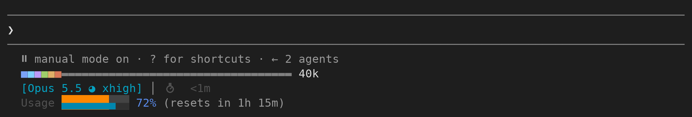

# slim-hud

A minimal heads-up display for [Claude Code](https://code.claude.com), drawn on the bottom rows of the screen. It is a Claude Code mod: a plugin that draws inside Claude Code itself, so there is no status-line script to run.



- **Context bar:** what fills the context window, one color per category (system prompt, tools, MCP, memory, skills, messages), then the tokens in use. Type `/ctx`, click the bar, or press `ctrl+x b` to show a legend.
- **Model line:** the model, its effort level, and how long the session has run.
- **Usage bar:** your 5-hour limit, and the 7-day one where your plan has it. The top half of each cell is quota used and the bottom half is time gone in the window, so color running past the blue means you are spending faster than the clock. Then the percent used and the time to reset. Shown on Claude subscription accounts only.
- **Todo line:** the todo in progress, when Claude keeps a todo list.

Nothing is drawn for a figure Claude Code has not reported yet.

## Install

Needs Claude Code 2.1.287 or newer. At the prompt of a Claude Code session:

```
/plugin install slim-hud --marketplace RichieHakim/slim-hud
```

Answer `y` to add the marketplace, then choose a scope. From a shell instead:

```
claude plugin install slim-hud --marketplace RichieHakim/slim-hud
```

If you also run a status-line script such as claude-hud, its rows stay above these; you can remove it from `statusLine` in `~/.claude/settings.json`. To turn slim-hud off, open `/plugin`.

Mods are an early-access Claude Code feature, so a Claude Code update may need a fix here.

## Credit

The context bar is adapted from Hamza Zafar's [context-bar](https://github.com/hamzafer/claude-code-mods) and the usage bar follows [claude-hud](https://github.com/jarrodwatts/claude-hud)'s stacked bar. MIT license.
